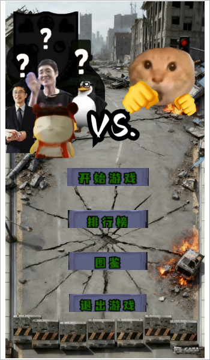
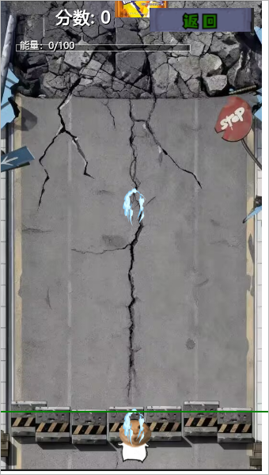

# Rail Shooter · 轨道射击

一个使用 **C++17、Qt 6 和 CMake** 开发的竖屏射击游戏，也是一次多人协作的课程项目。

操控底部的猫猫左右移动，自动开火，守住防线。随着分数增长，更多敌人和 Boss 会加入战斗。击破奖励箱可以获得随机强化，积满能量后还能释放环形弹幕大招。

## 游戏画面

| 主菜单 | 实际对局 |
| --- | --- |
|  |  |

## 游戏内容

- **自动射击与横向移动**。调整站位拦截敌人，敌人突破底部防线后本局结束。
- **多种敌人**。包含普通敌人、精英、Boss，以及为周围敌人提供防御或速度加成的光环敌人。
- **随机强化**。击破奖励箱后，随机提升射速、增加伤害，或获得限时散射。
- **能量大招**。得分同时积攒能量，能量满后可释放向四周扩散的弹幕。
- **图鉴与排行榜**。从主菜单查看角色介绍，或查看本地保存的前十条高分记录。

## 操作方式

| 按键或操作 | 功能 |
| --- | --- |
| `A` / `←` | 向左移动 |
| `D` / `→` | 向右移动 |
| `E` | 能量满时释放大招 |
| 自动触发 | 持续向上射击 |
| 点击游戏中的返回按钮 | 保存本局得分并回到主菜单 |

## 构建与运行

### 开发环境

| 依赖 | 要求 |
| --- | --- |
| C++ 编译器 | 支持 C++17 |
| Qt | Qt 6，包含 Core、Gui、Widgets、Multimedia 模块 |
| CMake | 3.20 或更高版本 |
| Ninja | 用于下方的命令行构建 |

已在 **Windows、Qt 6.9.0、MinGW 13.1 64 位** 环境完成 Release 编译和主程序启动验证。安装 Qt 时，选择相匹配的编译器和桌面开发套件。

先克隆项目。

```sh
git clone https://github.com/EternalSpace131/rail-shooter.git
cd rail-shooter
```

### 使用 Qt Creator

1. 打开仓库根目录的 `CMakeLists.txt`。
2. 选择已安装的 Qt 6 桌面 Kit，配置构建目录。
3. 按 `Ctrl+R` 构建并运行，点击主菜单的“开始游戏”进入对局。

### 使用命令行

在已配置 Qt、MinGW、CMake 和 Ninja 的命令行环境中执行。将 `CMAKE_PREFIX_PATH` 替换为本机 Qt 套件的安装路径。

```bat
cmake -S . -B build -G Ninja -DCMAKE_BUILD_TYPE=Release -DCMAKE_PREFIX_PATH="C:/Qt/6.9.0/mingw_64"
cmake --build build --parallel 4
build\RailShooterGame.exe
```

如果 CMake 提示找不到 `Qt6Config.cmake`，请检查 Qt 的安装路径。如果提示缺少 Multimedia，请为当前 Qt 版本和编译器补装对应模块。

### 得分保存

排行榜记录分数和时间，按分数从高到低保留前十条。点击游戏内的返回按钮或关闭对局窗口时，会尝试保存本局得分。

本地记录文件 `ranking.json` 位于可执行文件所在目录，运行时需要该目录可写。图片与音频由 `res.qrc` 编入程序。

## 代码结构

```text
rail-shooter/
├── CMakeLists.txt
├── res.qrc                 # Qt 资源清单
├── assets/
│   ├── images/             # 角色、场景、按钮与图鉴图片
│   └── sounds/             # 背景音乐与角色音效
├── data/
│   └── ranking.json        # 排行榜初始资源
├── docs/                   # 游戏截图
└── src/
    ├── main.cpp            # 应用入口
    ├── Core/               # 主菜单、对局、图鉴和排行榜页面
    ├── Entities/           # 玩家、敌人、子弹、奖励箱与游戏循环
    ├── GameLogic/          # 地图边界与防线
    └── Manager/            # 实体、碰撞、音频和排行榜管理
```

阅读游戏逻辑可以从 `src/Entities/gameworlditem.cpp` 开始，这里负责输入、自动射击、出怪、强化和大招。`src/Manager/EntityManager.cpp` 负责实体更新与碰撞结算，敌人的参数和动画定义在 `src/Entities/EnemySpec.cpp` 中。

本项目由课程小组共同完成。
